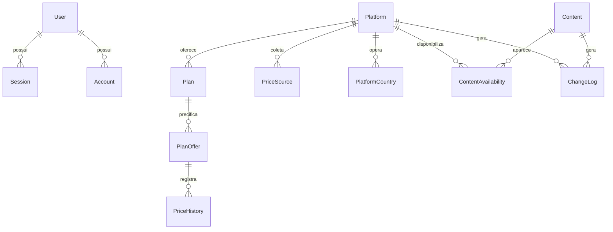

# Banco de dados

## Visão geral

- **Schema:** `prisma/schema.prisma`
- **Client gerado:** `app/generated/prisma/` (ignorado no git; gerado no
  `postinstall`)
- **Migrations:** `prisma/migrations/` (travadas para **Postgres**)
- **URL de migrations:** `prisma.config.ts` usa `DIRECT_URL` e, na falta dela,
  `DATABASE_URL`; sem nenhuma, `file:./dev.db`.
- **Runtime:** `lib/db.ts` cria um singleton de `PrismaClient` com o adapter
  escolhido por `lib/db-adapter.ts`.

## Modelos

### Autenticação (Better Auth)

| Modelo | Papel | Campos-chave |
|---|---|---|
| `User` | Conta do usuário | `email` (único), `name`, `image`, `emailVerified` |
| `Session` | Sessão ativa | `token` (único), `expiresAt`, `userId`, `ipAddress`, `userAgent` |
| `Account` | Vínculo com provedor | `providerId`, `providerAccountId`, tokens OAuth |
| `Verification` | Tokens de verificação | `identifier`, `token` (único), `expiresAt` |

`Session` e `Account` usam `onDelete: Cascade` a partir de `User`.
`Account` tem unicidade em `(providerId, providerAccountId)`.

### Catálogo e preços

| Modelo | Papel | Campos-chave |
|---|---|---|
| `Platform` | Serviço de streaming | `name`, `slug` (únicos), `logo`, `website`, `color` |
| `Plan` | Tier canônico da plataforma | `tierKey`, `name`; único por `(platformId, tierKey)` |
| `PlanOffer` | Oferta real por país e ciclo | `countryCode`, `currency`, `amount`, `billingCycle`, `billingMonths`, `ads`, `quality`, `status` |
| `PriceHistory` | Série histórica da oferta | `offerId`, `amount`, `currency`, `recordedAt` |
| `PriceSource` | Configuração de coleta | `platformId`, `countryCode`, `url`, `parserKey`, `renderMode`, `isActive` |
| `ScrapeRun` | Auditoria de tentativas de coleta | `status`, `httpStatus`, `offersFound`, `error`, `startedAt` |
| `PlatformCountry` | Disponibilidade comercial no país | PK `(platformId, countryCode)`, `status` |
| `Content` | Título do catálogo | `title`, `originalTitle`, `slug` (único), `type`, `year`, `genre`, `rating` |
| `ContentAvailability` | Título × plataforma | único `(contentId, platformId)`, `available`, `addedAt`, `removedAt` |
| `ChangeLog` | Histórico de mudanças | `type`, `description`, `platformId`, `contentId`, `countryCode`, `oldValue`, `newValue` |

### Relações principais



## Restrições importantes

- `Plan` é único por `(platformId, tierKey)`. Use o `tierKey` estável
  (`padrao`, `premium`, `com-anuncios`) para reencontrar o mesmo tier em países
  diferentes.
- `PlanOffer` é único por `(planId, countryCode, billingCycle)`. A mesma oferta
  não pode existir duas vezes no mesmo ciclo; ofertas anuais e mensais
  coexistem.
- `PlanOffer` tem índice em `(countryCode, status)` para alimentar listas e
  comparativos.
- `PriceHistory` indexa `(offerId, recordedAt)`.
- O histórico pertence à **oferta**, não ao plano.

## Migrations

```bash
# desenvolvimento (Postgres)
pnpm db:migrate

# aplicar migrations existentes
pnpm exec prisma migrate deploy

# resetar (apaga dados)
pnpm db:reset
```

> As migrations usam sintaxe Postgres e `migration_lock.toml` está fixado em
> `postgresql`. Para trabalhar com SQLite local, use `pnpm db:push` em vez de
> `migrate dev`.

### Criando uma migration

1. Edite `prisma/schema.prisma`.
2. Rode `pnpm db:migrate --name descricao_curta` (ou
   `pnpm prisma migrate dev`).
3. Revise o SQL gerado em `prisma/migrations/`.
4. Atualize este documento se o modelo mudou.

## Seed

```bash
pnpm db:seed
```

O seed em `prisma/seed.ts` é idempotente e cria:

- 11 plataformas: Looke, Prime Video, Crunchyroll, Netflix, Globoplay, YouTube
  Premium, Disney+, HBO Max, Apple TV+, Paramount+ e MUBI.
- `PlatformCountry` para os 12 países (Brasil opera; Looke e Globoplay não
  operam fora do Brasil; os demais ficam como `UNKNOWN`).
- Planos e ofertas iniciais **apenas do Brasil**, em BRL, com `sourceType:
  "SEED"`.
- Quatro pontos de `PriceHistory` por oferta (valores levemente variados) para
  o gráfico ter dados.
- Catálogo de exemplo com 15 títulos e disponibilidade nas plataformas.

O seed **não sobrescreve** ofertas existentes; preços verificados depois vêm do
importador CSV ou do scraper. Veja [Preços e ofertas](pricing.md).

## Migração de SQLite legado para Neon

O script `scripts/migrate-sqlite-to-neon.ts` copia dados do schema antigo
(SQLite) para Postgres já no modelo de preço nativo. Ele preserva IDs e
timestamps, converte planos antigos em ofertas do Brasil e é idempotente.

```powershell
$env:TARGET_DATABASE_URL = "postgresql://..."
$env:SOURCE_DATABASE_URL = "file:./dev.db"   # opcional; este é o padrão
npx tsx scripts/migrate-sqlite-to-neon.ts
```

```bash
TARGET_DATABASE_URL="postgresql://..." pnpm exec tsx scripts/migrate-sqlite-to-neon.ts
```

O script imprime a contagem de origem/destino por modelo ao final. Ele usa
`SOURCE_DATABASE_URL` (padrão `file:./dev.db`) e exige `TARGET_DATABASE_URL`
com prefixo `postgres`.

## Cuidados

- `dev.db` é um arquivo SQLite local usado como fallback; não é fonte de
  verdade em produção.
- O Prisma Client é gerado em `app/generated/prisma/`, fora do git. Rode
  `pnpm db:generate` após instalar ou mudar o schema.
- `ChangeLog` referencia `platformId`/`contentId` opcionalmente. Ao apagar
  registros relacionados, revise a política de integridade antes de alterar o
  schema.
